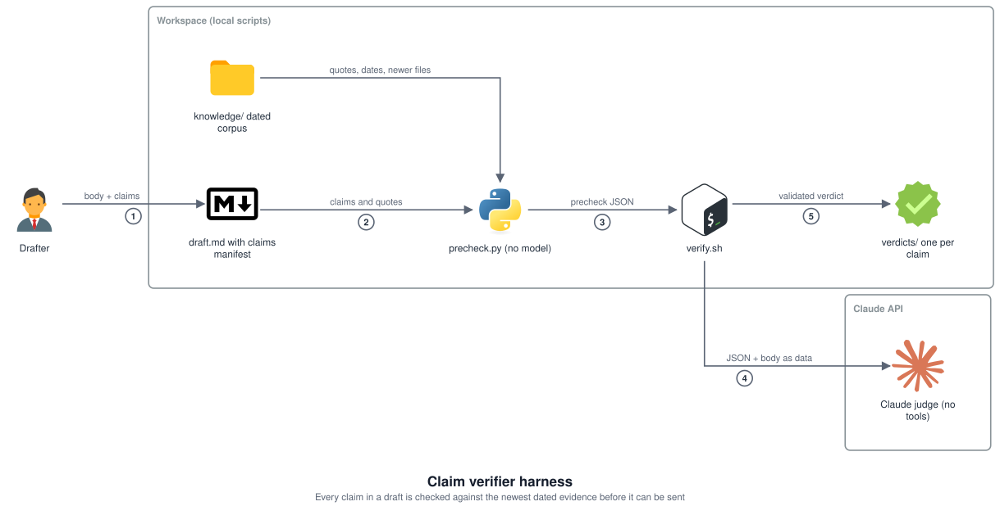

# Claim verifier harness

An evaluation gate for LLM-drafted outbound email. Every factual claim in a draft is checked
against the newest dated evidence in a project corpus before the draft can be registered as
sendable. Extracted from a live consulting workspace (client identifiers removed) where it has
gated outbound email since August 2026.

## Why it exists

A drafted email told a client sponsor that an ongoing monthly cost was about 61 percent higher
than it really was. The claim matched its source, a workbook, and the workbook matched the
builder script it came from. All three were stale: the resource had been deleted weeks earlier,
and the evidence of that sat in the same workspace. Agreement between a document and its own
source proves internal consistency, not currency. The gate is built to catch exactly that.

## Shape

<picture>
  <source media="(prefers-color-scheme: dark)" srcset="docs/architecture-dark.svg">
  
</picture>

1. The drafter writes the body and a `## Claims` manifest: each claim with its evidence file,
   a verbatim quote, topics and type.
2. `emails/precheck.py`, deterministic and with no model, checks each claim is in the body, its
   evidence exists and its quote is really there. It runs a staleness query (any corpus file on
   the same topics dated after the evidence), extracts every number, date, domain, identifier and
   name in the body and greps the corpus for each, and auto-settles a claim whose quote sits in a
   dated direct observation with nothing newer.
3. It writes `emails/prechecks/<slug>.json`: claims, excerpts, values, uncovered lines, problems.
4. `emails/verify.sh` sends that JSON and the body to the judge (`emails/claim-judge.md`), a model
   with no tools, which applies the existence and transcript rules and returns one verdict per
   claim as JSON.
5. `verify.sh` validates the verdict, writes `emails/verdicts/<slug>.json`, and discards it if the
   body changed while the judge ran. The diagram source is `docs/architecture.yaml`.

Verdicts: `SUPPORTED`, `CONTRADICTED`, `STALE`, `UNVERIFIABLE`, `INCOHERENT`, `NOT_A_CLAIM`,
`PLATFORM_RULE`. Anything other than `SUPPORTED`, `NOT_A_CLAIM` or `PLATFORM_RULE` blocks.

## The two rules the judge enforces

- **Existence rule.** A claim that something exists, is running, is billing or will be removed
  needs a dated direct observation: a platform pull, an export, a query result, or a written
  statement from the owner. A design document, a model, a builder script or a prior deliverable
  is not an observation, whatever it asserts.
- **Transcript rule.** A meeting transcript is an observation of a conversation and nothing else.
  It never supports a precise value: a name, a domain, an identifier, a port, a figure.

## Anti-anchoring by construction

The drafter's reasoning lives in the notes half of the draft, which the judge never sees. The
precheck lifts out only claim text, evidence pointer, quote and dates. The judge has no tools at
all: `claude -p --tools ""` with the precheck JSON and body in the prompt, enforced rather than
instructed, because a search-capable agent given a fast path still searched. It returns the
verdict as JSON and `verify.sh` validates it and writes the file. The body is untrusted text, so
a judge that could write files would let a crafted draft write wherever the session could.

## Numbers

- Before: the search-capable verifier cost about two minutes and 50 to 66 thousand tokens per
  six-line email, because it re-found evidence the drafter had already cited.
- After (measured 31 October 2026 on a nine-line draft, Haiku judge): 42 seconds, three turns,
  about two cents; 139k tokens of input served from cache, 79k written to cache, 7.5k output.
  The win is latency and determinism, not raw tokens: the model no longer searches, and most of
  its input is the fixed judge prompt and the precheck JSON.
- Over 18 drafts (August to September 2026): 128 claims judged; 88 supported, 2 contradicted,
  3 unverifiable, 31 not a claim, 3 platform rules, 1 incoherent.
- Labels come from three places: the drafter's manifest (claim, evidence file, verbatim quote,
  topics, type), the deterministic auto-settle rule, and a human reading every verdict before
  anything is sent.

## Run the example

The repository carries a made-up engagement: a four-file corpus in `knowledge/` and a draft,
`emails/wave-two-update.md`, whose licence figure was superseded by a later recount.

```
python3 emails/precheck.py emails/wave-two-update.md    # deterministic, no model, no key
./emails/verify.sh emails/wave-two-update.md            # precheck, then the judge (needs the claude CLI)
```

The precheck flags the licence claim as `CHECK` with a newer file on the same topics. The judge
then returns one `STALE` and two `SUPPORTED`, so the draft is blocked. On 1 November 2026 that run
took 18 seconds and $0.007 with a Haiku judge.

`emails/emails.py` and `knowledge/build_index.py` are minimal stand-ins for the workspace modules
the gate was extracted from (body extraction and digest; corpus frontmatter). `MON-N` evidence
references resolve through an optional task tracker named by `TRACKER_PY`; without it they
resolve to nothing.
